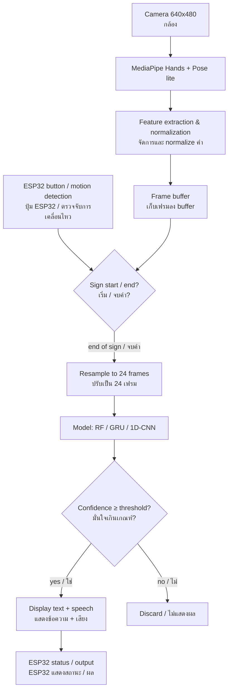

# Sign Language Translation via Integrated AI/ML

> Real-time Thai Sign Language word recognition from a camera, using MediaPipe landmarks, machine learning models, and an ESP32 controller.
>
> ระบบแปลภาษามือไทยแบบคำเดี่ยวจากกล้องแบบเรียลไทม์ โดยใช้จุดพิกัดร่างกายจาก MediaPipe ร่วมกับโมเดล Machine Learning และไมโครคอนโทรลเลอร์ ESP32

**Computer Engineering (CPE), King Mongkut's University of Technology Thonburi (KMUTT)**
**ภาควิชาวิศวกรรมคอมพิวเตอร์ มหาวิทยาลัยเทคโนโลยีพระจอมเกล้าธนบุรี**

`TODO: course name / ชื่อวิชา` · `TODO: instructor / อาจารย์ผู้สอน` · `TODO: semester / ภาคการศึกษา`

---

## Table of Contents / สารบัญ

1. [Background & Problem / ที่มาและปัญหา](#1-background--problem--ที่มาและปัญหา)
2. [Scope / ขอบเขต](#2-scope--ขอบเขต)
3. [System Overview / ภาพรวมระบบ](#3-system-overview--ภาพรวมระบบ)
4. [Hardware / อุปกรณ์](#4-hardware--อุปกรณ์)
5. [Software & Installation / ซอฟต์แวร์และการติดตั้ง](#5-software--installation--ซอฟต์แวร์และการติดตั้ง)
6. [Project Structure / โครงสร้างโปรเจกต์](#6-project-structure--โครงสร้างโปรเจกต์)
7. [Usage / วิธีใช้งาน](#7-usage--วิธีใช้งาน)
8. [Data Collection & Processing / การเก็บและจัดการข้อมูล](#8-data-collection--processing--การเก็บและจัดการข้อมูล)
9. [Models & Training / โมเดลและการฝึก](#9-models--training--โมเดลและการฝึก)
10. [Results / ผลลัพธ์](#10-results--ผลลัพธ์)
11. [Limitations & Future Work / ข้อจำกัดและแนวทางพัฒนา](#11-limitations--future-work--ข้อจำกัดและแนวทางพัฒนา)
12. [Team & References / ผู้จัดทำและแหล่งอ้างอิง](#12-team--references--ผู้จัดทำและแหล่งอ้างอิง)

---

## 1. Background & Problem / ที่มาและปัญหา

**EN** — For many Deaf people in Thailand, Thai Sign Language (TSL) is their first language, while written Thai is a second language with different grammar. Most hearing people do not know sign language, and qualified interpreters are limited. This creates barriers in short, everyday interactions such as service counters, hospitals, and shops. This project explores whether a low-cost camera-based system can recognize a small set of common signs and present them as text and speech for hearing people.

**TH** — สำหรับคนหูหนวกจำนวนมาก ภาษามือไทยเป็นภาษาแรก ส่วนภาษาไทยเขียนเป็นภาษาที่สองซึ่งมีไวยากรณ์ต่างกัน ขณะที่คนได้ยินส่วนใหญ่ไม่รู้ภาษามือ และล่ามภาษามือมีจำนวนจำกัด ทำให้เกิดอุปสรรคในการสื่อสารสั้น ๆ ในชีวิตประจำวัน เช่น เคาน์เตอร์บริการ โรงพยาบาล หรือร้านค้า โปรเจกต์นี้ทดลองสร้างระบบต้นทุนต่ำที่ใช้กล้องจดจำท่าภาษามือที่ใช้บ่อยจำนวนหนึ่ง แล้วแสดงผลเป็นข้อความและเสียงพูดให้คนได้ยินเข้าใจ

`TODO: insights from Deaf community / ข้อมูลจากผู้ใช้ภาษามือ (รอตอบกลับ)`

---

## 2. Scope / ขอบเขต

| Item / หัวข้อ | Scope / ขอบเขต |
|---|---|
| Recognition type / ประเภทการแปล | Isolated signs (one word or short phrase at a time) / คำเดี่ยวหรือวลีสั้น ทีละคำ |
| Vocabulary / จำนวนคำ | `TODO` words (target 10–15) / `TODO` คำ (เป้าหมาย 10–15 คำ) |
| Use case / สถานการณ์ใช้งาน | `TODO: e.g. service counter` / `TODO: เช่น เคาน์เตอร์บริการ` |
| User position / ตำแหน่งผู้ใช้ | Seated, 70–90 cm from camera, head to waist visible / นั่ง ห่างกล้อง 70–90 ซม. เห็นหัวถึงเอว |
| Output / ผลลัพธ์ | Text on screen + speech / ข้อความบนจอ + เสียงพูด |

**Vocabulary / รายการคำ**

| # | Thai / ไทย | English | Notes / หมายเหตุ |
|---|---|---|---|
| 1 | `TODO` | `TODO` | |
| 2 | `TODO` | `TODO` | |
| 3 | `TODO` | `TODO` | |

**Out of scope / นอกขอบเขต** — Continuous signing at natural conversation speed, sentence-level grammar, and facial expressions.
การแปลภาษามือต่อเนื่องด้วยความเร็วเท่าการสนทนาจริง ไวยากรณ์ระดับประโยค และการแสดงสีหน้า

---

## 3. System Overview / ภาพรวมระบบ



**EN** — The main program runs in Python on a computer. The ESP32 acts as the physical controller: a record button for data collection and manual mode, status indicators, and (planned) output devices.

**TH** — โปรแกรมหลักทำงานด้วย Python บนคอมพิวเตอร์ ส่วน ESP32 ทำหน้าที่เป็นตัวควบคุมทางกายภาพ ได้แก่ ปุ่มสำหรับเก็บข้อมูลและโหมดกดเอง ไฟแสดงสถานะ และอุปกรณ์แสดงผล (อยู่ระหว่างวางแผน)

---

## 4. Hardware / อุปกรณ์

| Component / อุปกรณ์ | Model / รุ่น | Purpose / หน้าที่ | Status / สถานะ |
|---|---|---|---|
| Computer / คอมพิวเตอร์ | `TODO: CPU / RAM / OS` | Runs MediaPipe and model / รัน MediaPipe และโมเดล | ✅ |
| Camera / กล้อง | `TODO` | Video input / รับภาพ | ✅ |
| ESP32 | `TODO: e.g. ESP32 DevKit V1` | Button input, status, serial link / รับปุ่ม แสดงสถานะ สื่อสารกับคอม | ✅ |
| Push button / ปุ่มกด | `TODO` | Start/stop recording / เริ่ม-หยุดบันทึก | ✅ |
| LED | `TODO` | Recording status / แสดงสถานะการบันทึก | ✅ |
| OLED display / จอ OLED | `TODO: e.g. SSD1306 0.96"` | Show translated text / แสดงคำที่แปล | 🔲 planned |
| DFPlayer Mini + speaker / ลำโพง | `TODO` | Play pre-recorded word audio / เล่นเสียงคำ | 🔲 planned |
| LED light / ไฟส่องหน้า | `TODO` | Consistent lighting / ให้แสงสม่ำเสมอ | 🔲 planned |

### Wiring / การต่อวงจร

| ESP32 Pin | Connected to / ต่อกับ |
|---|---|
| `TODO` | Button / ปุ่ม |
| `TODO` | LED |
| `TODO` (SDA/SCL) | OLED |
| `TODO` (TX/RX) | DFPlayer |

`TODO: wiring diagram image / รูปวงจร → docs/images/wiring.png`

---

## 5. Software & Installation / ซอฟต์แวร์และการติดตั้ง

**Requirements / สิ่งที่ต้องมี**

| Software | Version / เวอร์ชัน |
|---|---|
| Python | `TODO` |
| mediapipe | `TODO` |
| opencv-python | `TODO` |
| numpy | `TODO` |
| scikit-learn | `TODO` |
| torch | `TODO` |
| pyserial | `TODO` |
| Arduino IDE / PlatformIO | `TODO` |

> Check versions with / ดูเวอร์ชันได้ด้วย `pip show <package>`

**Install / ติดตั้ง**

```bash
git clone TODO
cd sign-language-translation
python -m venv venv
# Windows: venv\Scripts\activate
# macOS/Linux: source venv/bin/activate
pip install -r requirements.txt
```

**ESP32 firmware / โค้ด ESP32** — Open `firmware/esp32_controller/esp32_controller.ino` in Arduino IDE, select the board and port, then upload.
เปิดไฟล์ `firmware/esp32_controller/esp32_controller.ino` ใน Arduino IDE เลือกบอร์ดและพอร์ต แล้วอัปโหลด

---

## 6. Project Structure / โครงสร้างโปรเจกต์

```
sign-language-translation/
├── README.md
├── requirements.txt
├── config.py                  # shared settings / ค่าตั้งที่ใช้ร่วมกัน
│
├── src/
│   ├── features.py            # landmark selection + normalization (shared everywhere)
│   │                          # เลือกจุด + normalize (ใช้ร่วมกันทุกขั้นตอน)
│   ├── segmenter.py           # sign start/end detection / ตรวจจับเริ่ม-จบคำ
│   ├── serial_link.py         # ESP32 communication / สื่อสารกับ ESP32
│   ├── check_camera.py        # detection-rate test mode / โหมดทดสอบ % การเจอมือ
│   ├── collect_data.py        # record training samples / เก็บข้อมูลฝึก
│   ├── dataset.py             # load, split by person, augment / โหลด แบ่งตามคน ขยายข้อมูล
│   ├── models.py              # GRU / 1D-CNN definitions / นิยามโมเดล
│   ├── train_sklearn.py       # Random Forest / LightGBM
│   ├── train_torch.py         # GRU / 1D-CNN
│   ├── evaluate.py            # metrics, confusion matrix, latency / วัดผล
│   └── realtime.py            # main real-time app / โปรแกรมหลักแบบเรียลไทม์
│
├── firmware/
│   └── esp32_controller/
│       └── esp32_controller.ino
│
├── data/
│   ├── raw/                   # one .npy per sample: <word>/<person>_<n>.npy
│   │                          # ข้อมูลดิบ แยกโฟลเดอร์ตามคำ
│   └── processed/             # resampled + split datasets / ข้อมูลที่ปรับแล้ว
│
├── models/                    # trained models (not committed if large)
│   ├── rf.pkl                 # โมเดลที่ฝึกแล้ว
│   ├── gru.pt
│   ├── scaler.pkl
│   └── labels.json
│
├── audio/                     # pre-recorded MP3 per word for DFPlayer
│                              # ไฟล์เสียงแต่ละคำสำหรับ DFPlayer
├── results/                   # plots and evaluation outputs / กราฟและผลการวัด
└── docs/
    └── images/                # photos, diagrams, screenshots / รูปประกอบ
```

---

## 7. Usage / วิธีใช้งาน

| Step / ขั้นตอน | Command / คำสั่ง | Description / คำอธิบาย |
|---|---|---|
| 1. Check camera setup | `python src/check_camera.py` | Shows hand/pose detection rate in real time / แสดง % การตรวจจับมือแบบเรียลไทม์ |
| 2. Collect data | `python src/collect_data.py --word TODO --person TODO` | Hold ESP32 button while signing / กดปุ่ม ESP32 ค้างขณะทำท่า |
| 3. Train baseline | `python src/train_sklearn.py` | Random Forest baseline |
| 4. Train neural net | `python src/train_torch.py --model gru` | GRU or 1D-CNN |
| 5. Evaluate | `python src/evaluate.py` | Saves metrics and plots to `results/` / บันทึกผลลง `results/` |
| 6. Run | `python src/realtime.py --model gru --port TODO` | Real-time translation / แปลแบบเรียลไทม์ |

`TODO: confirm commands once scripts are finished / ยืนยันคำสั่งเมื่อเขียนสคริปต์เสร็จ`

---

## 8. Data Collection & Processing / การเก็บและจัดการข้อมูล

### 8.1 Collection setup / การเก็บข้อมูล

| Item / หัวข้อ | Value / ค่า |
|---|---|
| Signers / จำนวนผู้ทำท่า | `TODO` |
| Samples per word per signer / ตัวอย่างต่อคำต่อคน | `TODO` (target 30–50 total per word / เป้าหมาย 30–50 ต่อคำ) |
| Position / ตำแหน่ง | Seated, 70–90 cm, camera at chest height / นั่ง 70–90 ซม. กล้องระดับอก |
| Variation / ความหลากหลาย | Different lighting, backgrounds, slight angle changes / แสง ฉากหลัง และมุมต่างกันเล็กน้อย |

### 8.2 Features per frame / ข้อมูลต่อเฟรม

| Source / ที่มา | Points / จุด | Values / ค่า |
|---|---|---|
| Pose: nose, shoulders ×2, elbows ×2, wrists ×2, thumb/index/pinky ×2 | 13 | 26 |
| Hands: left + right | 21 × 2 = 42 | 84 |
| Hand-detected flags / ค่าบอกว่าเจอมือ | – | 2 |
| **Total / รวม** | **55** | **112** |

Each sign is resampled to **24 frames → 24 × 112 input**.
แต่ละคำถูกปรับให้มี **24 เฟรม → ข้อมูลเข้าโมเดลขนาด 24 × 112**

### 8.3 Processing steps / ขั้นตอนการจัดการค่า

1. **Body normalization** — Pose points relative to shoulder midpoint, divided by shoulder width.
   จุดลำตัวเทียบกับกึ่งกลางไหล่ แล้วหารด้วยความกว้างไหล่
2. **Hand normalization** — Hand points relative to that hand's wrist, divided by hand size.
   จุดนิ้วมือเทียบกับข้อมือของมือนั้น แล้วหารด้วยขนาดมือ
3. **Fixed hand slots** — Left/right hands always in the same position in the vector.
   ใส่มือซ้าย/ขวาในช่องตายตัวเสมอ
4. **Missing hands** — Gaps of 1–3 frames are filled from neighbors; longer gaps are zero with flag = 0.
   มือหาย 1–3 เฟรมเติมจากเฟรมข้างเคียง นานกว่านั้นใส่ 0 และ flag = 0
5. **Bystander filtering** — Hands are accepted only if their wrist is close to the main person's pose wrist.
   รับเฉพาะมือที่ข้อมืออยู่ใกล้ข้อมือของผู้ใช้หลัก (กรองมือคนเดินผ่าน)
6. **Resampling** — Each sign resampled to 24 frames by time.
   ปรับทุกคำให้มี 24 เฟรมตามเวลา
7. **Scaling (neural nets only)** — `StandardScaler` fitted on training data only.
   `StandardScaler` เฉพาะ neural network และ fit กับข้อมูลฝึกเท่านั้น

### 8.4 Sign segmentation / การตรวจจับเริ่ม-จบคำ

| Mode / โหมด | Method / วิธี |
|---|---|
| Manual / กดเอง | Hold ESP32 button while signing / กดปุ่มค้างขณะทำท่า |
| Auto / อัตโนมัติ | Start when hand speed > `TODO`; end after hand is still for ~0.25 s / เริ่มเมื่อมือขยับเร็วเกิน `TODO` จบเมื่อนิ่งประมาณ 0.25 วินาที |

---

## 9. Models & Training / โมเดลและการฝึก

**Data split / การแบ่งข้อมูล** — Split **by signer**, not by random sample, to measure performance on unseen people (`GroupShuffleSplit` / leave-one-person-out).
แบ่งข้อมูล **ตามผู้ทำท่า** ไม่สุ่มทีละตัวอย่าง เพื่อวัดความแม่นกับคนที่โมเดลไม่เคยเห็น

| Model / โมเดล | Library | Key settings / ค่าหลัก |
|---|---|---|
| Random Forest | scikit-learn | `n_estimators=300`, `max_features="sqrt"`, `class_weight="balanced"` |
| LightGBM (optional) | lightgbm | `TODO` |
| GRU | PyTorch | hidden 64, 1–2 layers, dropout 0.3 |
| 1D-CNN | PyTorch | `TODO` |

**Training (PyTorch) / การฝึก** — AdamW, lr 1e-3, weight decay 1e-4, batch 32, CrossEntropyLoss (label smoothing 0.1), ReduceLROnPlateau, gradient clipping 1.0, early stopping (patience 15).

**Augmentation / การขยายข้อมูล** — Small rotation (±10°), scaling, noise, and time stretching. No left-right flipping.
หมุนเล็กน้อย (±10°) ย่อขยาย ใส่ noise และยืดหดเวลา ไม่ flip ซ้าย-ขวา

**Confidence threshold / เกณฑ์ความมั่นใจ** — `TODO` (chosen from validation set / เลือกจากชุด validation)

---

## 10. Results / ผลลัพธ์

| Model / โมเดล | Test accuracy | Macro F1 | Inference time (ms) |
|---|---|---|---|
| Random Forest | `TODO` | `TODO` | `TODO` |
| GRU | `TODO` | `TODO` | `TODO` |
| 1D-CNN | `TODO` | `TODO` | `TODO` |

**Test on unseen signers / ทดสอบกับคนที่ไม่อยู่ในข้อมูลฝึก:** `TODO`

`TODO: results/confusion_matrix.png`
`TODO: results/loss_curve.png`

**Demo video / วิดีโอเดโม:** `TODO`

---

## 11. Limitations & Future Work / ข้อจำกัดและแนวทางพัฒนา

### Limitations / ข้อจำกัด

- **Isolated signs only** — Users must pause briefly between signs. Continuous recognition at natural signing speed remains an open research problem, especially for Thai Sign Language with limited public data.
  **แปลได้ทีละคำ** ผู้ใช้ต้องเว้นจังหวะสั้น ๆ ระหว่างคำ การแปลแบบต่อเนื่องด้วยความเร็วจริงยังเป็นโจทย์วิจัยที่เปิดอยู่ โดยเฉพาะภาษามือไทยที่มีข้อมูลสาธารณะน้อย
- **Small vocabulary** — Only `TODO` words are supported.
  **คำศัพท์จำกัด** รองรับเพียง `TODO` คำ
- **No facial expressions or body grammar** — Sign language uses facial expressions as part of grammar; this system uses hands and upper-body points only.
  **ไม่รวมสีหน้าและไวยากรณ์ทางร่างกาย** ภาษามือใช้สีหน้าเป็นส่วนหนึ่งของไวยากรณ์ แต่ระบบนี้ใช้เฉพาะมือและลำตัวช่วงบน
- **Limited signer diversity** — Training data comes from a small number of signers, `TODO: who`, which may not reflect how native signers sign.
  **ผู้ทำท่ามีความหลากหลายน้อย** ข้อมูลฝึกมาจากคนจำนวนน้อย `TODO: ใคร` ซึ่งอาจต่างจากผู้ใช้ภาษามือจริง
- **Occlusion and hand orientation** — Signs with hands seen edge-on or pressed together (e.g. ไหว้) are harder for MediaPipe to detect.
  **มือถูกบังหรือหันด้านสัน** ท่าที่เห็นมือด้านข้างหรือประกบกัน (เช่น ไหว้) ตรวจจับได้ยากกว่า
- **Environment sensitivity** — Accuracy may drop with poor lighting, cluttered backgrounds, or a different camera position from training.
  **ไวต่อสภาพแวดล้อม** ความแม่นอาจลดลงเมื่อแสงไม่ดี ฉากหลังรก หรือตำแหน่งกล้องต่างจากตอนเก็บข้อมูล
- **One-way communication** — The system only translates sign to text/speech, not the reverse.
  **สื่อสารทางเดียว** แปลจากภาษามือเป็นข้อความ/เสียงเท่านั้น ไม่แปลกลับ

### Future work / แนวทางพัฒนา

- Continuous sign recognition using sliding windows and a "transition" class.
  รองรับการแปลแบบต่อเนื่องด้วยหน้าต่างเลื่อนและคลาส "ช่วงเปลี่ยนท่า"
- Larger vocabulary and common phrases trained as single units.
  เพิ่มคำศัพท์ และสอนวลีที่ใช้บ่อยเป็นหน่วยเดียว
- Collect data with and get feedback from Deaf signers.
  เก็บข้อมูลและรับคำแนะนำจากผู้ใช้ภาษามือจริง
- Add selected facial landmarks for grammatical expressions.
  เพิ่มจุดบนใบหน้าบางส่วนเพื่อรองรับสีหน้าที่เป็นไวยากรณ์
- Two-way communication: speech-to-text display for the Deaf user.
  สื่อสารสองทาง: แปลงเสียงพูดเป็นข้อความให้คนหูหนวกอ่าน
- Run on a phone or single-board computer for portability.
  ย้ายไปรันบนมือถือหรือบอร์ดคอมพิวเตอร์ขนาดเล็กให้พกพาได้
- Model optimization (ONNX Runtime / quantization) for lower latency.
  ปรับโมเดลให้เร็วขึ้น (ONNX Runtime / quantization)

---

## 12. Team & References / ผู้จัดทำและแหล่งอ้างอิง

### Team / ผู้จัดทำ

| Name / ชื่อ | Student ID / รหัสนักศึกษา | Responsibility / หน้าที่ |
|---|---|---|
| `TODO` | `TODO` | `TODO` |

### Acknowledgements / กิตติกรรมประกาศ

`TODO: people or organizations who advised on sign language / ผู้ให้คำแนะนำด้านภาษามือ`

### References / แหล่งอ้างอิง

- MediaPipe — https://ai.google.dev/edge/mediapipe
- scikit-learn — https://scikit-learn.org
- PyTorch — https://pytorch.org
- `TODO: Thai Sign Language dictionary / พจนานุกรมภาษามือไทยที่ใช้อ้างอิง`
- `TODO: related papers / งานวิจัยที่เกี่ยวข้อง`