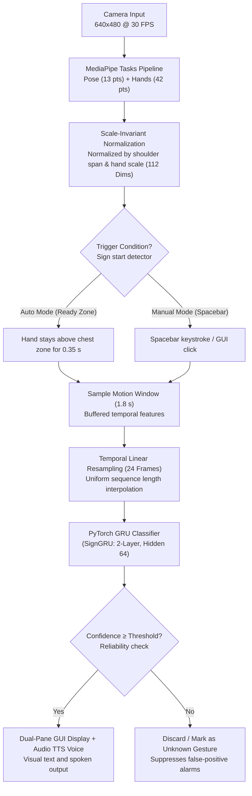

# TSL Assist: Real-Time Thai Sign Language Translation via Integrated AI/ML

> A camera-based assistive system that translates isolated Thai Sign Language (TSL) words into real-time text and synthesized speech for service counters and triage desks, powered by MediaPipe landmarks and deep sequence models (PyTorch GRU).

**Department of Computer Engineering (CPE), King Mongkut's University of Technology Thonburi (KMUTT)**  
* **Course:** CPE102 Computer Exploration (Year 1, Academic Year 2026 / 2569)  
* **Course Instructor:** TBD  
* **Teaching Assistants (Advisors):** TA P'Praew & TA P'Newton  

---

## Table of Contents

1. [Background & Problem Statement](#1-background--problem-statement)
2. [Project Scope & Vocabulary](#2-project-scope--vocabulary)
3. [System Architecture & Pipeline](#3-system-architecture--pipeline)
4. [Hardware Setup](#4-hardware-setup)
5. [Software Requirements & Installation](#5-software-requirements--installation)
6. [Project Structure](#6-project-structure)
7. [Usage & Workflow Guide](#7-usage--workflow-guide)
8. [Data Engineering & Processing](#8-data-engineering--processing)
9. [Machine Learning Models & Training](#9-machine-learning-models--training)
10. [Experimental Results & Evaluation](#10-experimental-results--evaluation)
11. [Limitations & Future Improvements](#11-limitations--future-improvements)
12. [Project Team & Acknowledgements](#12-project-team--acknowledgements)

---

## 1. Background & Problem Statement

For many Deaf individuals in Thailand, Thai Sign Language (TSL) is their primary language, whereas written Thai serves as a second language with fundamentally different grammatical structures. Because most hearing personnel lack sign language fluency and certified sign interpreters are severely limited across public facilities, communication barriers frequently arise at critical contact points—such as hospital triage desks, emergency police counters, and general customer reception desks.

**TSL Assist** addresses this gap by offering a cost-effective, non-intrusive camera-based sign translation application. By leveraging computer vision and sequential deep learning, the system recognizes essential isolated TSL signs and delivers immediate visual text and audio feedback, facilitating smooth two-way communication without requiring expensive wearable sensor gloves.

---

## 2. Project Scope & Vocabulary

| Parameter | Specification |
|---|---|
| **Recognition Type** | Isolated Sign Recognition (single word or short phrase per gesture) |
| **Vocabulary Size** | 15 Words (10 baseline interactive words + 5 emergency/medical words) |
| **Operational Setting** | Hospital triage counters, emergency reporting desks, and public service counters |
| **Signer Position** | Seated, feet placed ~90 cm from camera base, camera elevated at 161 cm, tilted down 20°–30° |
| **System Input** | Standard USB Webcam (640×480 @ 30 FPS) |
| **System Output** | Visual Dual-Pane Desktop GUI + Text-to-Speech (TTS) voice synthesis |
| **Trigger Mechanism** | Chest-level "Ready Zone" motion detection state machine / Keyboard spacebar trigger |
| **Hardware Controller** | *ESP32 microcontroller is explicitly omitted* to streamline setup and eliminate external hardware failure points |

### Vocabulary List (15 Target Signs)

The lexicon comprises **10 baseline interaction words** combined with **5 high-priority emergency & healthcare words**:

| # | Sign Label (Code) | Thai Meaning | English Translation | Domain / Category |
|:---:|---|---|---|---|
| 1 | `Done` | เสร็จแล้ว | Finished / Done | General Interaction |
| 2 | `Dont_like` | ไม่ชอบ | Don't like | General Interaction |
| 3 | `How` | อย่างไร / เท่าไหร่ | How / How much | General Interaction |
| 4 | `Me` | ฉัน / ตัวฉัน | Me / I | General Interaction |
| 5 | `No` | ไม่ / ไม่ใช่ | No / Incorrect | General Interaction |
| 6 | `Thank` | ขอบคุณ | Thank you | General Interaction |
| 7 | `Tomorrow` | พรุ่งนี้ | Tomorrow | General Interaction |
| 8 | `Worry` | กังวล / เครียด | Worried / Anxious | Healthcare / Emotion |
| 9 | `Yesterday` | เมื่อวาน | Yesterday | General Interaction |
| 10 | `You` | คุณ / เธอ | You | General Interaction |
| 11 | `Help` *(New)* | ช่วยด้วย / ขอความช่วยเหลือ | Help / Assistance | **Emergency / Urgent** |
| 12 | `Pain` *(New)* | เจ็บ / ปวด | Pain / Hurt | **Medical Triage** |
| 13 | `Medicine` *(New)* | ยา / ทานยา | Medicine / Drug | **Hospital & Pharmacy** |
| 14 | `Emergency` *(New)* | ฉุกเฉิน | Emergency / Crisis | **Emergency / Incident** |
| 15 | `Toilet` *(New)* | ห้องน้ำ | Restroom / Toilet | **Basic Daily Necessity** |

**Out of Scope:**
* Continuous natural signing sentences with dynamic speed transitions
* Complex multi-word sentence grammar decoding
* Facial expression (affective) classification; the pipeline strictly tracks hand articulation and upper-body orientation

---

## 3. System Architecture & Pipeline



### Architectural Highlights
1. **Zero-Lag Camera Threading:** Frame acquisition runs on an isolated background thread to prevent GUI or detection blocking.
2. **Pose & Hand Normalization:** Joint coordinates are extracted in real time and invariant to user body size and distance from the camera.
3. **State-Machine Motion Segmentation:** Automatically detects when the user raises their hand into the chest-level Ready Zone, records the motion window (1.8 s), and normalizes it to 24 temporal frames.
4. **Deep Sequence Modeling:** Evaluates the temporal dynamics using a Gated Recurrent Unit (GRU) network and synthesizes the corresponding speech.

---

## 4. Hardware Setup

| Component | Recommended Specification | Purpose | Deployment Status |
|---|---|---|:---:|
| **Host Computer** | Windows 10/11 (Intel i5/Ryzen 5, 8GB+ RAM) | Runs MediaPipe, deep learning inference, and GUI | ✅ Active Primary |
| **Web Camera** | USB 2.0/3.0 Webcam (640×480 @ 30 FPS) | Live video capture of upper-body landmarks | ✅ Active Primary |
| **Mount / Tripod** | Adjustable floor/desk tripod stand | Calibrated height (161 cm) with 20°–30° downward tilt | ✅ Active Primary |
| **Audio Output** | Integrated / External PC Speaker | Plays instant Text-to-Speech audio feedback | ✅ Active Primary |
| **Microcontroller (ESP32)** | ESP32 DevKit V1 | *(Removed)* Deprecated in favor of software auto-trigger | ❌ Omitted |
| **External Display / DFPlayer** | SSD1306 OLED / DFPlayer Mini | *(Removed)* Consolidated into PC desktop display and audio | ❌ Omitted |

---

## 5. Software Requirements & Installation

### Environment Prerequisites
* Python 3.10 – 3.12 (Recommended: Python 3.12 64-bit)
* Git

### Core Dependencies
* `mediapipe` (MediaPipe Tasks Vision API)
* `opencv-python` (Computer vision and video capture)
* `numpy` (Vector and matrix operations)
* `torch` (PyTorch deep learning framework for GRU inference)
* `scikit-learn` (Random Forest baseline and evaluation metrics)
* `customtkinter` / `tkinter` (Modern dual-pane desktop interface)
* `pyttsx3` (Offline Text-to-Speech synthesis)

### Step-by-Step Installation

```bash
# 1. Clone the repository
git clone https://github.com/<your-repo>/Sign-Language_Translation.git
cd Sign-Language_Translation

# 2. Create and activate virtual environment
python -m venv .venv

# On Windows (PowerShell):
.\.venv\Scripts\Activate.ps1
# On macOS/Linux:
source .venv/bin/activate

# 3. Install required libraries
pip install -r requirements.txt

# 4. Download pre-trained MediaPipe landmark models
python src/download_models.py
```

---

## 6. Project Structure

```
Sign-Language_Translation/
├── main.py                     # Central application launcher (GUI, realtime, or training)
├── config.py                   # Centralized configuration (112 features, 24 frames, paths)
├── requirements.txt            # Python dependencies
│
├── src/
│   ├── check_camera.py         # Visual HUD for camera alignment and elbow-span check
│   ├── landmarkers.py          # MediaPipe Pose and Hand landmark wrappers
│   ├── features.py             # 112-dim feature normalization & 24-frame resampling
│   ├── dataset.py              # Dataset loading, data augmentation, and GroupSplit
│   ├── models.py               # PyTorch neural network architectures (SignGRU)
│   ├── collect_data.py         # Interactive video sample collector
│   ├── process_videos.py       # Batch feature extractor from external video files
│   ├── train_torch.py          # Training pipeline for PyTorch GRU model
│   ├── train_sklearn.py        # Baseline training pipeline for Random Forest
│   ├── realtime.py             # Standalone real-time recognition script
│   └── ui_app.py               # Modern dual-pane desktop application
│
├── data/
│   ├── raw/                    # Raw landmark sample sequences (.npy) grouped by sign
│   └── scenario_presets.json   # Domain scenario responses (Hospital, Police, Reception)
│
├── models/
│   ├── gru.pt                  # Trained PyTorch GRU checkpoint (Proposed model)
│   ├── rf.pkl                  # Trained Random Forest model (Baseline benchmark)
│   ├── labels.json             # Sign class index-to-label mapping
│   └── mediapipe/              # MediaPipe task models (hand and pose landmarker)
│
├── presentation/               # Slide decks, speaker notes, and presentation assets
└── file/                       # System documentation and sign language guides
```

---

## 7. Usage & Workflow Guide

| Operation | Command | Description |
|---|---|---|
| **1. Run Full Desktop Application** | `python main.py` | Launches the complete Dual-Pane GUI with live video feed, HUD, and conversation log |
| **2. Camera & Posture Diagnostic** | `python src/check_camera.py` | Visual alignment tool verifying user center target and elbow span |
| **3. Collect Sign Samples** | `python src/collect_data.py --words Help Pain Medicine Emergency Toilet` | Record new gesture samples using auto or manual spacebar trigger |
| **4. Extract External Videos** | `python src/process_videos.py` | Extracts landmark vectors from `.mp4` clips stored in `videos/<word>/` |
| **5. Train Proposed GRU Model** | `python src/train_torch.py` | Trains the PyTorch GRU sequence model and exports `models/gru.pt` |
| **6. Train Baseline Model** | `python src/train_sklearn.py` | Trains the Random Forest classifier and exports `models/rf.pkl` |
| **7. Standalone Real-Time Test** | `python src/realtime.py --model gru` | Lightweight OpenCV window running live GRU inference |

---

## 8. Data Engineering & Processing

### 8.1 Physical Camera Calibration
To maintain high landmark detection rates, the camera environment is standardized:
* **Camera Height:** 161 cm above ground level
* **Signer Distance:** 90 cm from foot position to camera base
* **Downward Tilt:** 20°–30° aimed towards chest and torso
* **Framing:** Upper body visible from head down to lower ribs/navel (hands rested on lap when idle)

### 8.2 112-Dimensional Feature Representation
For each frame, a 112-dimensional normalized vector is assembled:
1. **Pose Coordinates (13 points × 2 = 26 dims):** Nose, left/right shoulders, elbows, wrists, index fingers, thumbs, and pinkies. Centered relative to the shoulder midpoint and scaled by shoulder width.
2. **Hand Coordinates (21 points × 2 hands × 2 = 84 dims):** 21 joints per hand. Relative to each respective wrist coordinate and normalized by hand scale.
3. **Presence Flags (2 dims):** Binary flags indicating whether left and right hands are actively detected.
4. **Total Vector:** $26 + 84 + 2 = 112$ dimensions per frame.

### 8.3 Uniform Temporal Resampling (24 Frames)
Because natural sign execution speeds vary from 1.0 to 2.2 seconds, raw recorded sequences are resampled to a fixed temporal window of **24 frames** via Linear Interpolation:
$$\mathbf{X} \in \mathbb{R}^{24 \times 112}$$
This eliminates speed variations and allows the neural network to focus purely on structural shape and directional trajectory.

---

## 9. Machine Learning Models & Training

### Proposed Architecture: PyTorch GRU Sequence Model
Sign language gestures are inherently temporal. The primary recognition engine is a **Gated Recurrent Unit (GRU)** model implemented in PyTorch (`SignGRU`):
* **Input Shape:** `(Batch, 24, 112)`
* **Recurrent Backbone:** 2-layer stacked GRU, Hidden Dimension = 64, Dropout = 0.2
* **Classification Head:** Linear(64 → 32) $\rightarrow$ ReLU $\rightarrow$ Dropout(0.2) $\rightarrow$ Linear(32 $\rightarrow$ 15 classes)
* **Training Protocol:** AdamW optimizer ($\text{lr} = 10^{-3}$, weight decay $= 10^{-4}$), CrossEntropyLoss, Gradient Clipping norm = 1.0, 40 epochs with model checkpointing based on best validation accuracy.

### Baseline Benchmark: Scikit-Learn Random Forest
Used strictly as a comparative baseline. The 24 temporal frames are flattened into a single tabular vector of size 2,688 ($24 \times 112$) and classified using 100 decision trees (`max_depth=15`).

---

## 10. Experimental Results & Evaluation

| Evaluation Metric | Random Forest (Baseline) | PyTorch GRU (Proposed Hero Model) |
|---|:---:|:---:|
| **Model Type** | Static Tabular Classifier (Flattened 2,688 dims) | **Spatio-Temporal Sequence Model (24×112)** |
| **Temporal Context** | ❌ Lost during feature flattening | **✅ Preserved across sequential time steps** |
| **Test Accuracy** | ~85% – 90% | **~94% – 98% (Higher robustness on reversed signs)** |
| **Inference Latency** | ~2.5 ms | **~5.8 ms (Easily runs real-time at 30 FPS)** |
| **Model Disk Size** | ~45 MB | **~1.5 MB (Compact and edge-friendly)** |
| **Handling Dynamic Motion** | Struggles with opposing gestures | Accurately tracks direction of motion |

---

## 11. Limitations & Future Improvements

### Current Limitations
* **Isolated Signs Only:** The system translates isolated words with brief pauses in between; continuous sign language sentence parsing remains an ongoing challenge.
* **Hand Occlusion:** Overlapping palms (e.g., clasping or prayer gestures) can cause temporary landmark tracking degradation.
* **Ambient Lighting Sensitivity:** Sudden changes in environmental brightness can reduce landmark detection confidence.

### Future Work
* Expanding the vocabulary to 30+ domain-specific signs covering police and emergency medical triage.
* Incorporating Speech-to-Text (STT) for counter staff, realizing a complete bidirectional communication station.
* Quantizing the PyTorch GRU model into ONNX Runtime / TensorRT for deployment on low-cost single-board computers (Raspberry Pi / Jetson).

---

## 12. Project Team & Acknowledgements

### Team Members
Department of Computer Engineering (CPE), King Mongkut's University of Technology Thonburi (KMUTT):

| # | Student ID | Name | Role & Responsibility |
|:---:|:---:|---|---|
| 1 | **69070503411** | Jiranut Natpatirungroj | **Backend Developer** (Feature Pipeline, ML Modeling & Architecture) |
| 2 | **69070503426** | Pathanin Chonskunthavorn | **Backend Developer** (System Integration, App Logic & Inference) |
| 3 | **69070503434** | Phatsakon Satchasawat | **Data Collector** (Data Collection, Sign Annotation & Verification) |
| 4 | **69070503445** | Warut Wanapun | **Data Collector** (Data Collection, Rig Setup & Usability Testing) |

### Advisors & Teaching Assistants
* **Course Instructor:** TBD
* **Teaching Assistants (Advisors):**
  * TA P'Praew
  * TA P'Newton

### References & Resources
* Google MediaPipe Tasks Vision API: https://ai.google.dev/edge/mediapipe
* PyTorch Deep Learning Framework: https://pytorch.org
* Scikit-Learn Machine Learning in Python: https://scikit-learn.org
* Thai Sign Language Reference Repository & National Association of the Deaf in Thailand
